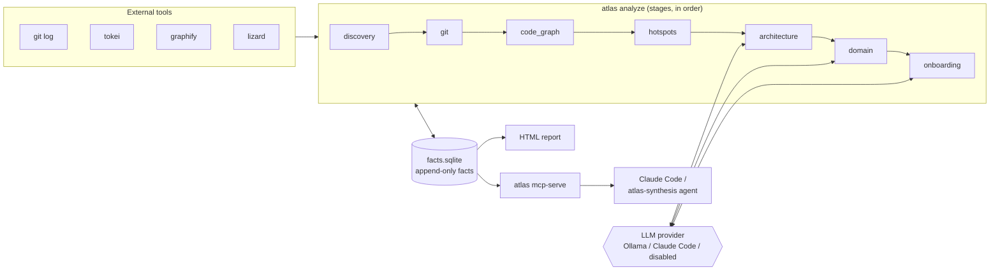

# Architecture

How Atlas is built, and why. Every decision below links to its entry in
[`specs/Design Decisions.md`](../specs/Design%20Decisions.md) (French), where the full
reasoning — and, for later fixes, the real bug that forced the decision — is recorded.

- [The big picture](#the-big-picture)
- [Code layout](#code-layout)
- [The fact model](#the-fact-model)
- [The pipeline](#the-pipeline)
- [Adapters: wrapping external tools](#adapters-wrapping-external-tools)
- [Deterministic analysis](#deterministic-analysis)
- [LLM orchestration](#llm-orchestration)
- [Outputs: report, MCP, agent](#outputs-report-mcp-agent)
- [Key decisions and why](#key-decisions-and-why)
- [How the project is developed](#how-the-project-is-developed)

---

## The big picture



Three layers, strictly ordered:

1. **Collect** — adapters run existing tools and normalize their output into facts (`observed`).
2. **Compute** — deterministic code derives metrics from facts: centrality, communities, cycles, hotspot scores (`computed`).
3. **Interpret** — three LLM passes turn a *bounded selection* of facts and file contents into architecture, domain and onboarding hypotheses that must cite fact ids (`hypothesis`).

Consumers (report, MCP server) only ever read the fact store. Nothing talks to a tool or
an LLM at read time.

---

## Code layout

```
src/project_intel/
├── facts/          Fact/Evidence/Entity model, SQLite FactStore, typed value accessors
├── adapters/       AdapterManifest contract + runner (presence/version checks, isolation)
├── discovery/      signatures.toml (frameworks, build, CI, IaC), tokei adapter, scope, docs
├── git_analysis/   churn + co-change from `git log --numstat`
├── code_graph/     GraphProvider protocol, graphify provider, metrics (networkx), aggregation
├── hotspots/       lizard complexity adapter, percentile scorer, weights
├── llm/            LLMProvider (Ollama, Claude Code, Disabled), orchestrator, cache, citations, budget
├── architecture/   stage + prompt + schema (pattern catalogue)
├── domain/         candidate selector + stage + prompt + schema
├── onboarding/     stage + prompt + schema (entry points, avoid, open questions)
├── html_report/    single-file renderer (+ vendored mermaid.min.js)
├── mcp_server/     global stdio server + bounded query functions
└── cli/            click entry point, stage registry, pipeline types
```

Each analysis package exposes one `STAGE` object; [`cli/registry.py`](../src/project_intel/cli/registry.py)
lists them in order. Adding a stage = one import + one list entry.

---

## The fact model

Everything Atlas knows is a `Fact` ([`facts/model.py`](../src/project_intel/facts/model.py)):

| Field | Meaning |
|---|---|
| `id` | UUID (UUIDv5 derived from run + content for most producers, so re-rendering is stable) |
| `type` | e.g. `git_churn`, `centrality`, `hotspot_score`, `architecture_hypothesis`, `stage_run_result` |
| `subject` / `predicate` / `object` | Entity refs (`File`, `Symbol`, `Repository`…) — relations like `imports` use all three |
| `value` | Type-specific payload; read it through the typed accessors in [`facts/value_schemas.py`](../src/project_intel/facts/value_schemas.py) |
| `provenance` | `observed` · `computed` · `inferred` · `hypothesis` |
| `confidence` | `[0,1]`; 1.0 for observed/computed, explicit for the rest |
| `evidence` | Typed refs: file, line, symbol, commit, config, tool output, documentation, external |
| `source_analyzer` | `name@version` of the producer |
| `run_id`, `created_at`, `schema_version` | Which analysis produced it, when, under which schema |

Rules that matter when you touch the code:

- **Facts are immutable and the store is append-only.** A new run adds facts under a new `run_id`; nothing is updated in place. This keeps history, and lets a stage run alone reuse upstream facts from an earlier run (`FactStore.run_id_with`).
- **Paths are relative to the analyzed `PATH`**, never absolute and never relative to the Git root — the join between Git facts and graph facts depends on it (Feature 04b).
- **Unknown is explicit.** Each stage outcome is itself stored as a `stage_run_result` fact (`ok` / `failed` / `skipped` + detail such as `not_analyzed: llm_disabled`), so any consumer can tell "nothing found" from "never ran" from "LLM failed".
- **Consumers read facts of one run.** The report and every MCP query are scoped to the latest run (or an explicit `run_id`); the report falls back to an earlier run per section, and says so.

---

## The pipeline

`atlas analyze` ([`cli/main.py`](../src/project_intel/cli/main.py)) builds a
`PipelineContext` (store, path, run id, scope, LLM provider) and runs every registered stage
through `_run_stage_safe`: an exception fails that stage only, the outcome is persisted, the
next stage runs. The report is generated at the end whatever happened. Exit code is 1 if any
stage failed.

Stages run **sequentially**, and so do the adapters inside a stage. (`adapters/runner.py`
has a thread-pool `run_adapters`, but no stage uses it yet — `discovery`, `git` and
`code_graph` are independent and could run in parallel.)

---

## Adapters: wrapping external tools

An adapter is data, not a class hierarchy ([`adapters/manifest.py`](../src/project_intel/adapters/manifest.py)):
name, own semver, category, supported ecosystems, a command (argv list or Python callable),
a `normalize(raw, ctx) -> list[Fact]` function, optional version range and an install hint.

The runner guarantees, for every adapter:

1. **Presence check** (`shutil.which`) → `skipped:tool_not_found` with the install hint.
2. **Version check** against the declared range → `skipped:version_mismatch`.
3. **Isolated execution** (120 s timeout for CLI tools) → `failed` with the error, never a crash of the run.
4. **Normalization** to `Fact`s only — no free-form output leaves an adapter.

Adapters are tested against recorded real tool output in `tests/fixtures/`, so CI does not
need the tools installed.

---

## Deterministic analysis

| Concern | How | Where |
|---|---|---|
| Frameworks, build, package managers, CI, Docker/K8s/Helm, IaC | Declarative signature table (manifest files, dependency names, file patterns) | `discovery/data/signatures.toml` |
| Languages, LOC | tokei | `discovery/tokei_adapter.py` |
| Churn, co-change | `git log --numstat --no-merges`, full history; co-change = pairs seen together in ≥ 2 commits | `git_analysis/` |
| Symbols, imports, calls | graphify (`graphify update <path>` → `graphify-out/graph.json`), behind a `GraphProvider` protocol | `code_graph/graphify_provider.py` |
| Centrality | networkx in/out degree centrality | `code_graph/metrics.py` |
| Communities | Louvain (networkx, fixed seed → reproducible) | `code_graph/metrics.py` |
| Cycles | Strongly connected components of size > 1 | `code_graph/metrics.py` |
| Complexity | lizard (in-process Python library) | `hotspots/complexity_adapter.py` |
| Hotspot score | Each of complexity, size (`log1p(LOC)`), centrality, churn is **percentile-ranked within the repo**, then weighted (1.0 / 0.5 / 1.0 / 1.0). Missing components are excluded and reported (`components_available`), never counted as 0. The breakdown is stored with the score. | `hotspots/scorer.py` |

---

## LLM orchestration

Stages never call a provider directly; they go through `LLMOrchestrator.complete(prompt, schema)`
([`llm/orchestrator.py`](../src/project_intel/llm/orchestrator.py)):

```
budget check → cache lookup → provider call (JSON constrained to the dataclass schema)
            → alias resolution → citation validation → (retry once on failure) → cache write
```

- **Providers** implement one method. `OllamaProvider` passes a JSON Schema derived from the response dataclass in Ollama's `format` field; `ClaudeCodeProvider` shells out to `claude -p --output-format json`; `DisabledProvider` returns `not_analyzed: llm_disabled`.
- **Bounded input.** Prompts contain selected facts and, for the domain pass, the content of a capped set of candidate files (top hotspots, then entrypoints, then workflow-named tests — at most 20 files, empty files dropped). The whole repository is never sent.
- **Short aliases.** Fact UUIDs are replaced by short aliases in the prompt and mapped back afterwards — small models copy `f12` reliably, not a 36-char UUID.
- **Citations are mandatory.** Every narrative field comes with `fact_ids`; any id that does not exist in the store fails validation. Onboarding additionally drops entries with no citation at all (Feature 10b).
- **Defensive normalization.** An architecture `pattern` outside the catalogue (layered, hexagonal, microservices, modular monolith, event-driven, MVC/MVVM, big ball of mud) becomes `uncatalogued`, with the raw value kept for debugging.
- **Cache** in `.atlas-cache/llm_cache.sqlite`, keyed on prompt content + schema version + provider + model. Invalidation is implicit: changed input → new key.
- **Failure** in one pass marks that section `not_analyzed: llm_failed` and the pipeline continues.

---

## Outputs: report, MCP, agent

**HTML report** ([`html_report/renderer.py`](../src/project_intel/html_report/renderer.py)) —
one self-contained file: embedded Mermaid, inline SVG community graph, search box,
click-to-open evidence panel, provenance badges with confidence. Deterministic sections are
written as template prose; interpretive sections show the LLM's own text with its citations.

**MCP server** ([`mcp_server/`](../src/project_intel/mcp_server/)) — one global stdio
server, `repo_path` on every call, a fresh store connection per call, no write path, every result
bounded (`limit ≤ 50`, `max_depth ≤ 10`), scoped to the latest run. The server and the CLI
are independent front-ends on the same store: humans use the CLI, agents use MCP.

**`atlas-synthesis` agent** ([`.claude/agents/atlas-synthesis.md`](../.claude/agents/atlas-synthesis.md)) —
not code: a documented recipe. It calls the CLI (to analyze when needed) and MCP (to read),
then writes its own HTML with two separated layers: relayed facts, and its own read. See
[agent-synthesis.md](agent-synthesis.md).

---

## Key decisions and why

| Decision | Why | Ref |
|---|---|---|
| Orchestrate tokei, git, graphify, lizard instead of parsing code ourselves | Mature tools already solve parsing; Atlas's value is the cross-cutting view | Q21, Q51, Q192 |
| Deterministic metrics, LLM only for architecture/domain/onboarding | Reproducible, cheap, explainable; the LLM is used where no algorithm exists | Q96–Q99 |
| Every fact carries provenance, confidence and evidence | The reader must be able to tell a measurement from a guess and check both | Q34–Q45, Q136 |
| SQLite, append-only, one store per analyzed path | No server, portable, queryable by the MCP server, keeps run history | Q46–Q49 |
| Frozen dataclasses, explicit ordering, snapshot tests | Specs are the source of truth; code must be regenerable without interface drift | [Regeneration contract](../specs/features/README.md#regeneration-contract) |
| Typed accessors for `fact.value` | Four real bugs were `value.get("wrong_key", default)` silently falling back | Q50b |
| Stages in an explicit registry, not plugins | One import per stage is enough; a plugin API would freeze interfaces too early | Q189–Q190 |
| Tool/stage failure is isolated and recorded as a fact | A partial map is useful; an opaque crash is not; "why is this empty" must be answerable later | Q29–Q30, Q107, Q180b |
| Local LLM (Ollama) by default, Claude Code optional, LLM fully disableable | Client code must be analyzable without leaving the machine | Q94–Q95, Q163–Q168 |
| JSON-schema-constrained output + citation validation + one retry | Structural guard against hallucination, tolerant of sampling noise in local models | Q80–Q81, Q104–Q106 |
| Architecture patterns from a closed catalogue | Comparable, validatable output; out-of-catalogue answers were file globs in practice | Q78, Q83b–c |
| Domain input capped at 20 files, prioritized | The "top_n" budget used to be exceeded 2× and diluted the model's attention | Q86–Q87b |
| Git paths rebased onto the analyzed path | Monorepo sub-directories split every file into two identities | Q116b |
| Self-contained HTML with vendored Mermaid | "Offline" must mean the diagrams actually render | Q129, Q137–Q138 |
| Narrative prose over lists of facts in the report | Early report was "a listicle of facts you have to click to read anything" | Q140b, Q140f |
| Global MCP server with `repo_path` per call, read-only, bounded | Register once for every repo; an agent must not trigger hidden cost or dump the graph | Q141–Q154, 12b |
| Analysis triggered by the agent via CLI, not by an MCP tool | Keeps MCP read-only; no hidden LLM cost behind a "read" | Q154, Q154c |
| Agent writes its own interpretation, separated from relayed facts | Otherwise it is just a worse copy of the report | Q154b, Q154g |

The full list — including what is deliberately **not** built yet and why — is in
[`specs/Design Decisions.md`](../specs/Design%20Decisions.md); its closing section lists
the decisions whose implementation is still pending.

---

## How the project is developed

- **Spec first.** Every change starts as a feature spec in [`specs/features/`](../specs/features/) scoped to decided questions; shipped specs are never rewritten — a later fix is a new lettered feature (e.g. `04b`) that builds on it.
- **Dogfooding.** After any change to `analyze`, run it for real on Atlas itself and on a larger real repository; most lettered fixes were found by reading real output, not by tests.
- **Logging convention.** `logging.getLogger(__name__)` everywhere; `WARNING` for any failure with actionable detail, `INFO` one line per external call, `DEBUG` raw payloads only.

See [CONTRIBUTING.md](../CONTRIBUTING.md) for the workflow.
